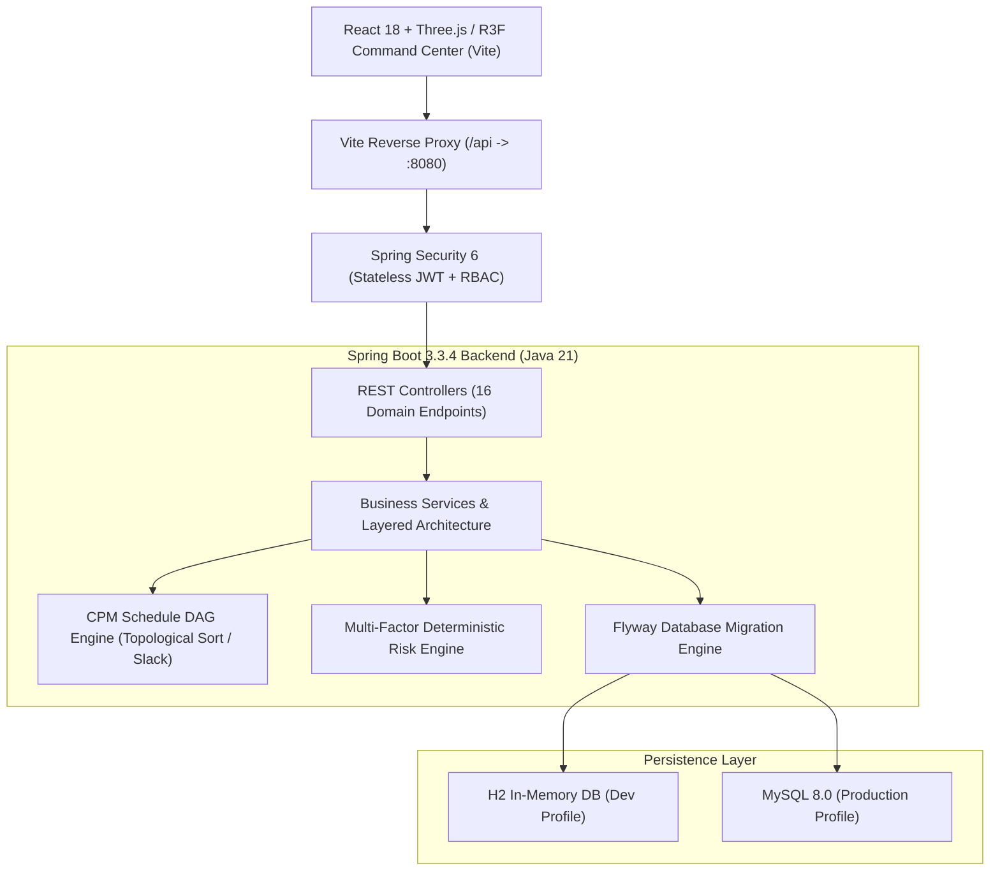

# NIRMAN (निर्माण) — 3D Digital Twin & Intelligent Construction Monitoring Platform

NIRMAN is an enterprise-grade **3D Digital Twin, Critical Path Method (CPM) Schedule Simulator, and Multi-Factor Risk Prediction Engine** engineered for intelligent high-rise construction monitoring.

Developed for real-time site visibility, NIRMAN eliminates schedule delays, cost overruns, and safety blind spots by unifying architectural BIM models, physical site telemetry, workforce allocation, and supply chain logistics into a single proactive Command Center.

---

## 🏛️ System Architecture

NIRMAN is architected as a layered full-stack system:



---

## 🚀 Key Features

### 1. 🏗️ Interactive 3D Digital Twin (BIM & Site Telemetry)
- Real-time 3D visualization powered by **Three.js** and **React Three Fiber**.
- Visualizes 14 building levels, basement raft foundations, podiums, and structural columns.
- Heavy machinery tracking including radial zone sweeps for Liebherr Tower Crane TC-01, transit mixers, and excavators.
- Material staging yard bounding boxes with real-time stock status indicators.

### 2. ⏱️ Critical Path Method (CPM) Schedule Engine
- Mathematical DAG scheduler implemented in Java ([`ScheduleDAG.java`](file:///Users/kanish/nirman%20/backend/src/main/java/com/nirman/simulation/ScheduleDAG.java)).
- Performs topological sort, forward pass ($ES, EF$), backward pass ($LS, LF$), and total float/slack calculation ($LS - ES$).
- Automatically identifies critical path work packages and highlights bottleneck activities.

### 3. 🎯 Multi-Factor Deterministic Risk Engine
- Explainable, deterministic risk scoring formula:
  $$\text{Risk Index} = 0.40 \times \text{Schedule Risk} + 0.35 \times \text{Resource Risk} + 0.25 \times \text{Safety Risk}$$
- Dynamic risk categorization (Low $<25$, Moderate $25\text{--}50$, High $50\text{--}75$, Critical $>75$) with actionable mitigation recommendations.

### 4. 🔮 Isolated What-If Schedule Simulator
- Non-destructive scenario sandbox allowing project managers to simulate trade crew surges, material delivery delays, and task duration changes.
- Calculates projected project completion date, schedule variance (days ahead/behind), and budget delta in real time without mutating baseline contracts.

### 5. 📊 Executive Command Center & Governance
- Real-time S-Curve (Planned Baseline vs Actual Progress).
- Task status distribution donut charts and trade shift utilization indicators.
- Role-based safety incident reporting and resolution workflows.
- Exportable CSV audit logs and sprint reports.

---

## 🛠️ Technology Stack

| Layer | Technologies |
| :--- | :--- |
| **Backend** | Java 21, Spring Boot 3.3.4, Spring Security 6, Spring Data JPA, Hibernate 6, Lombok |
| **Database & Migration** | H2 (In-Memory Dev), MySQL 8.0, Flyway 10.x |
| **Frontend** | React 18, TypeScript, Vite, Tailwind CSS, Lucide Icons |
| **3D Graphics** | Three.js, React Three Fiber (`@react-three/fiber`), Drei (`@react-three/drei`) |
| **API & Security** | RESTful JSON, JWT (HMAC-SHA256), OpenAPI / Swagger UI 3.0 |

---

## 🔑 Demo Credentials

All seeded demo accounts use the default password: **`password123`**

| Role | Username | Full Name | Permissions |
| :--- | :--- | :--- | :--- |
| **Project Manager** | `pm_sharma` | Rajesh Sharma | Full project administration & schedule approvals |
| **System Admin** | `admin` | Vikramaditya Rao | System-wide configuration & access governance |
| **Site Engineer** | `eng_patel` | Aakash Patel | Task progress updates & zone inspections |
| **Safety Officer** | `safety_singh` | Harpreet Singh | Safety incident logging & corrective action resolution |

---

## ⚡ Quickstart Guide

### Prerequisites
- **Java Development Kit (JDK)**: Version 21 or higher
- **Node.js**: Version 18 or higher (with npm)
- **Apache Maven**: Version 3.8+ (or use wrapper)

### 1. Start the Backend Server

```bash
cd backend
export JAVA_HOME="/opt/homebrew/opt/openjdk@21/libexec/openjdk.jdk/Contents/Home" # macOS Homebrew JDK 21
mvn spring-boot:run
```
- Backend starts at: `http://localhost:8080/`
- Swagger UI Documentation: `http://localhost:8080/swagger-ui.html`
- H2 Database Console: `http://localhost:8080/h2-console` (JDBC URL: `jdbc:h2:mem:nirmandb`, User: `sa`, Password: *(empty)*)

### 2. Start the Frontend Application

```bash
cd frontend
npm install
npm run dev
```
- Open `http://localhost:5173/` in your browser.
- The platform will connect to the live backend with the green `● API Live (8080)` indicator.

### 3. Run Automated Tests

```bash
cd backend
mvn test
```
Verifies CPM topological ordering, forward/backward pass slack calculation, and risk formula accuracy.

---

## 📄 License
MIT License. Built for Smart Infrastructure & Autonomous Construction Monitoring.
